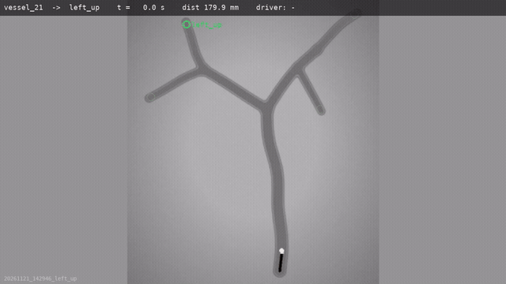

# 2D steerable-catheter navigation simulator

A simulated 2-DoF steerable catheter (insertion length + tip bend angle) in 2D
vessel phantoms. It's built as ROS2-style nodes on a small in-process pub/sub bus
(no ROS install). Teleoperation, scripted demonstrations and learned policies all
drive the robot through the same topics. Every run can be recorded as raw,
timestamped streams and converted into a LeRobot dataset.

<p align="center">
  
  <br>
  <em>Trained ACT policy reaching <code>left_up</code> in a validation vessel (<code>vessel_21</code>). <a href="docs/media/demo.mp4">MP4 version</a></em>
</p>

**Quick reference: [CHEATSHEET.md](CHEATSHEET.md)** has every command of the pipeline, with options and examples.

```bash
uv venv .venv && uv pip install --python .venv/bin/python -r requirements.txt   # + system ffmpeg
.venv/bin/python launch.py                                   # teleop (keyboard)
```

---

## 1. Pipeline: data collection → dataset → training → planning

```
  collect (launch.py)          inspect (replay.py)         convert                     train        plan
  teleop / autopilot /   ──>   view, --sync, --resim  ──>  tools/convert_lerobot.py ──> TBD    ──>   TBD
  policy + takeover            data/raw/<model>/<ep>/      data/lerobot/<name>/
```

### 1.1 Set up

```bash
uv venv .venv
uv pip install --python .venv/bin/python -r requirements.txt
uv pip install --python .venv/bin/python lerobot==0.4.4      # only needed for step 1.4
```

`ffmpeg` must be on the PATH (or `pip install imageio-ffmpeg`).

Check the camera size in `config.json` (`camera.width` / `height`, default
1280 × 720) and the video downsampling (`recording.video_scale`, default
0.5 → 640 × 360 video). Set these **before** collecting: every episode in one
LeRobot dataset must have the same size.

### 1.2 Collect raw episodes

| how | command |
|---|---|
| Teleop: press **Enter** to start/stop a recording | `python launch.py --model vessel_02` |
| Teleop, cycling (**N** / **P**) only through training vessels | `python launch.py --split train` |
| Scripted expert, headless | `python collect_auto.py --models vessel_02,vessel_03 --episodes 5 --noise 0.3` |
| Scripted expert on every training vessel | `python collect_auto.py --split train --episodes 3 --noise 0.3` |
| Teleop with a policy on standby: **G** lets it drive, any motion key takes back control | `python launch.py --split train --policy training/act_policy.py:ACTSimPolicy --policy-arg checkpoint=outputs/act_catheter/best` |
| Policy drives first, you take over when needed | add `--commander policy` to the line above |

Each recording becomes one directory:

```
data/raw/<model>/<YYYYmmdd_HHMMSS>_<target>/
    video.mp4      grayscale camera stream, no UI (camera size × video_scale)
    streams.npz    every topic as its own timestamped stream (see §3.3)
    meta.json      model, cameras, config, success, sources, ...
```

Recording only logs; it never pairs or resamples, so you can change how the
data is aligned later without collecting it again.

### 1.3 Inspect and verify

```bash
python replay.py data/raw/vessel_02/<episode>            # replay (F feature maps, I the recorded video)
python replay.py data/raw/vessel_02/<episode> --sync     # alignment + timing report
python replay.py data/raw/vessel_02/<episode> --resim    # re-run the physics from the log (should be 0 error)
```

### 1.4 Convert to a LeRobot dataset

```bash
python tools/convert_lerobot.py data/raw --out data/lerobot/catheter_nav_train --split train
python tools/convert_lerobot.py data/raw --out data/lerobot/catheter_nav_val   --split val
python tools/convert_lerobot.py data/raw/vessel_02 --out data/lerobot/v02_small \
    --scale 0.5 --only-success --sources teleop,takeover --overwrite
python tools/convert_lerobot.py data/raw --out x --dry-run      # only list what would be used
```

| option | meaning |
|---|---|
| `--scale` | output size relative to the recorded video. Feature maps are recomputed at that size, not resized. |
| `--split`, `--only-success`, `--sources`, `--models` | episode filters (vessel split from the model file, the rest from `meta.json`) |
| `--action-align last\|first`, `--state-align hold\|interp` | alignment rules (§2.4) |
| `--fill-gaps` | repeat frames over timing gaps instead of skipping the episode |
| `--hold-end 2.0` | append this many seconds of "arrived, stay still" to every episode that ends in the target: last frame and joint state repeated, action = state; 0 disables |
| `--vcodec` | LeRobot video codec (default `h264`) |

The converter writes a standard LeRobot dataset plus
`<out>/meta/sync_report.json`. For each episode, the report lists frames, timing
gaps, state lag, commands per frame and action sources.

The dataset has these features (H × W = video size × scale):

| key | type | content |
|---|---|---|
| `observation.state` | float32 (2,) | `[length_mm, bend_deg]` when the frame was taken |
| `action` | float32 (2,) | `[length_mm, bend_deg]` the target commanded in response to the frame |
| `observation.images.cam` | video (H, W, 3) | grayscale camera frame, copied into 3 identical channels |
| `observation.images.x_goal_map` | image (H, W, 3) | U feature map, encoded as uint8 |
| `observation.images.y_goal_map` | image (H, W, 3) | V feature map, encoded as uint8 |
| `task` | text | `"navigate to <target> in <model>"` |

LeRobot 0.4 only stores 3-channel images, so grayscale data is repeated
across all 3 channels. Goal maps are stored as `q = round((u + 1)/2 · 255)`;
in training, recover U and V in [−1, 1] with:

```python
from catheter_sim.lerobot_export import decode_goal_map
u = decode_goal_map(sample["observation.images.x_goal_map"])     # exact to 1/255
```

Load the dataset with `LeRobotDataset("local/catheter_nav", root="data/lerobot/catheter_nav")`.

### 1.5 Train a policy (ACT)

```bash
python training/check_act.py --root data/lerobot/catheter_nav          # dataset <-> ACT compatibility check
python training/training.py --root data/lerobot/catheter_nav_train --val-root data/lerobot/catheter_nav_val \
    --out outputs/act_catheter --steps 20000 --batch-size 16 --chunk-size 60 --n-action-steps 60
```

[training/training.py](training/training.py) follows LeRobot's `act_training_example.py`,
adapted to lerobot 0.4.4 and to a local dataset:

- **Relative actions:** for the frame at t, the model predicts
  `action[t+i] − state[t]` for i = 0 … chunk_size−1. These are joint-target
  offsets from where the robot is when the frame is taken. The action
  normalisation statistics are recomputed for these offsets. Use `--absolute`
  to train on absolute targets instead.
- **Checkpoints:** saved to `<out>/step_NNNNNN/`, `<out>/last/` and, with
  `--val-root`, `<out>/best/` (lowest validation L1). Each holds the model, its
  processors and statistics, and `training_meta.json` (fps, image size,
  relative or absolute, chunk settings).
- **Validation:** masked L1 of the predicted chunk, also reported in mm and degrees.

### 1.6 Planning: TBD

### 1.7 Deploy and evaluate a policy

A trained ACT checkpoint runs through [training/act_policy.py](training/act_policy.py):

```bash
python launch.py --commander policy --policy training/act_policy.py:ACTSimPolicy \
    --policy-arg checkpoint=outputs/act_catheter/best --model vessel_21        # watch; take over with any key, G resumes
python launch.py --commander policy --policy training/act_policy.py:ACTSimPolicy \
    --policy-arg checkpoint=outputs/act_catheter/best --headless --split val --episodes 2   # score
```

Every frame, the wrapper does the following:
1. **Encode:** the live observation is encoded exactly like a dataset row.
2. **Predict, when the queue is empty:** the model predicts a chunk. Relative
   offsets are turned into absolute targets using the joint state at
   prediction time. The first `n_action_steps` targets go into a queue.
3. **Send:** one target from the queue goes to the robot.

A takeover or resume clears the queue. `--policy-arg n_action_steps=5`
overrides how many actions are executed per chunk.

**Recording an evaluation with videos.** Save into a separate folder, so the
runs don't end up in your training data, then render annotated copies:

```bash
python launch.py --commander policy --policy training/act_policy.py:ACTSimPolicy \
    --policy-arg checkpoint=outputs/act_catheter/best --split val --episodes 1 \
    --record --set recording.data_dir=data/eval/run1
python tools/render_video.py data/eval/run1 --out videos/run1
```

`render_video.py` draws onto the recorded camera video:
- the active target and the tip path
- a status bar: model → target, time, distance to target, driver
- a final TARGET REACHED / NOT REACHED banner

The recorded `video.mp4` itself stays the plain camera stream that the policy
saw. `--size video` renders at the recorded size instead of the camera size.

For your own policy class:

```python
from catheter_sim.policy_api import Policy

class MyPolicy(Policy):
    rate_hz = 10
    input_size = (320, 180)       # (W, H): use the size of the dataset you trained on
    def __init__(self, ckpt): ...
    def reset(self, info): ...    # new episode: model, target, camera_info
    def act(self, obs):           # see below
        return target_length_mm, target_bend_deg
```

`obs` contains:

| key | content |
|---|---|
| `image` | (H, W) uint8 grayscale frame |
| `feature_u`, `feature_v` | float maps computed at `input_size` |
| `joint`, `joint_vel` | current joint state and velocities |
| `last_action` | target the robot is currently tracking |
| `t` | capture stamp of the image |
| `target_name` | current target |

For a model trained on the LeRobot export,
`catheter_sim.lerobot_export.observation_to_frame(obs)` returns the observation
in exactly the dataset's layout.

```bash
python launch.py --commander policy --policy my_policy.py:MyPolicy --policy-arg ckpt=best.pt     # watch + take over
python launch.py --commander policy --policy my_policy.py:MyPolicy --headless --episodes 5 --split val    # tune
python launch.py --commander policy --policy my_policy.py:MyPolicy --headless --episodes 5 --split test   # final score
```

`policies/example_policy.py` has three examples:
- `CreepPolicy`: a minimal template.
- `FeatureMapPolicy`: a hand-written baseline that uses only the image and the feature maps.
- `ReplayPolicy`: replays a raw episode's aligned actions open-loop, as a pipeline test.

---

## 2. Code architecture

### 2.1 Layers

```
 entry points   launch.py (builds + runs the node graph)   teleop.py / collect_auto.py (shortcuts)
                replay.py   tools/convert_lerobot.py   tools/make_models.py
 ─────────────────────────────────────────────────────────────────────────────────────────────
 nodes          catheter_sim/nodes/   world.py (task, robot, camera, feature_map)
                                      commanders.py (teleop, autopilot, policy, mux)
                                      recording.py (recorder)   viewer.py   supervisor.py
 ─────────────────────────────────────────────────────────────────────────────────────────────
 middleware     bus.py (Bus, Node, topics, timers, clock, seq)   msgs.py (message dataclasses)
 ─────────────────────────────────────────────────────────────────────────────────────────────
 data           recorder.py (raw format, video I/O)  sync.py (alignment)  dataset.py (Episode)
                lerobot_export.py (schema, goal-map codec, conversion)
 ─────────────────────────────────────────────────────────────────────────────────────────────
 core           catheter.py (rod physics)  actuator.py (lag, speed limit)  env.py (CatheterEnv)
                vessel.py (models, distance field)  featuremap.py  render.py  autopilot.py
                config.py  policy_api.py
```

Lower layers never import higher ones. The physics core (`env.py` and below)
knows nothing about the bus. The nodes wrap it, and the data layer only reads
files.

### 2.2 Node graph

```
 viewer ──/ui/keys──> teleop ─┐
                     policy ──┼─> mux ──/robot/joint_target──> robot ──/robot/joint_state──>
                  autopilot ──┘                                  │       /sim/ground_truth
                                                                 v
            camera ──/camera/image, /camera/info      feature_map ──/nav/feature_map
            task ──/sim/world, /nav/target, /task/status          recorder <── all of the above
```

| node | file | role |
|---|---|---|
| `task` | world.py | Loads the vessel model and picks the target. Publishes `/sim/world`, `/nav/target` and `/task/status` (distance, success). |
| `robot` | world.py | Takes joint targets, clamps them to the limits, then applies the delay, the first-order lag (80 ms) and the speed limit (40 mm/s, 360°/s). Then solves the catheter physics and publishes `/robot/joint_state` and `/sim/ground_truth`. |
| `camera` | world.py | Renders the plain scene (no UI) in grayscale at 30 fps. The tip fiducial is bright. Stamps each frame at capture. `camera.latency` optionally delays delivery. |
| `feature_map` | world.py | Publishes the latched U/V maps at the camera resolution. Recomputes them when the target changes. |
| `teleop` / `policy` / `autopilot` | commanders.py | Commanders. Each publishes candidate joint targets. |
| `mux` | commanders.py | Forwards one commander to the robot and handles takeover (any motion key) and resume (G). |
| `recorder` | recording.py | Logs every stream with stamps (§3.3). |
| `viewer` | viewer.py | The window: keyboard, colour scene, overlays, HUD. It only subscribes, so nothing it draws reaches the data. |
| `supervisor` | supervisor.py | Runs headless batches: for each model and target it resets, records, waits for success or timeout, then moves on. |

`launch.py` decides which nodes exist from the command-line flags. `main()`
builds the `Bus`, creates the nodes, calls `task.start()` (which loads the first
vessel), then `bus.spin()`. Nodes only talk through topics, so for a physical
setup you replace `robot` and `camera` with a hardware driver and a frame
grabber that publish the same topics. Nothing else changes.

### 2.3 One tick

The bus runs at 60 Hz on a sim clock. Timers fire in priority order within a
tick, and `publish()` delivers synchronously to every subscriber:

```
 viewer input (0) → supervisor (10) → policy poll (19) → teleop/policy/autopilot (20) → mux (30)
 → recorder start (35) → robot steps physics (40) → camera captures, every 2nd tick (50) → viewer draws (90)
```

Two clock modes:
- **realtime**: the default with a window. Sim time tracks wall time, and the policy runs in a worker thread, so the robot keeps moving while it thinks.
- **lockstep**: `--lockstep`, and the default with `--headless`. Each tick waits for every node, so runs are deterministic and faster than real time.

### 2.4 Time and synchronisation

Every message carries two fields:

- **`stamp`**: the sim time at which the data was *valid*, i.e. measured or captured, not when it was published.
- **`seq`**: a bus-wide counter. It orders every message strictly, including messages with equal stamps; for example, a command and a frame from the same tick.

The camera sets both at capture, so a delayed frame keeps its true capture time.
The recorder also logs `recv`, the time each message arrived, which shows
delivery latency.

`catheter_sim/sync.py` aligns the streams to the camera frames, which are the
dataset's rows. For frame k with stamp tₖ and sequence number sₖ:

| field | rule |
|---|---|
| `observation.state` | latest joint state with seq < sₖ, i.e. what existed when the frame was taken (`hold`). `interp` linearly interpolates at tₖ instead, for unsynchronised hardware. |
| `action` | last command with sₖ < seq < sₖ₊₁: the target in effect when the next frame is captured, i.e. the response to frame k (`last`). If none arrived (slow policy), the previous target is held. |
| goal maps | latest feature map with seq < sₖ, so the map switches on the exact frame where the target changes |
| timing | frame stamps must be exactly 1/fps apart; anything else is reported as a gap |

The deployed policy sees the same thing: the newest frame and the newest joint
state, and its command is applied before the next frame.

### 2.5 Feature maps

For target centre (x_a, y_a), in pixel-index coordinates of the image they
belong to:

```
U[j, i] = (i − x_a) / c · m[j, i] + (1 − m[j, i])
V[j, i] = (j − y_a) / c · m[j, i] + (1 − m[j, i])
```

- i is the column (x, + right) and j the row (y, + down).
- m = 1 if the pixel centre is inside the lumen.
- c = max(W, H) − 1.
- Inside the vessel, U and V lie in [−1, 1]; outside, they are exactly 1.

Maps are never resized. They are always recomputed from the vessel's distance
field at the target resolution, using `CameraInfo.scaled()`, which maps image
edges to image edges exactly as a frame resize does. As a result, map pixel
(i, j) is video pixel (i, j) at every size: the recorded video, the LeRobot
export and the policy input. The code is in `featuremap.py`.

---

## 3. Reference

### 3.1 Controls (window)

| key | action |
|---|---|
| W / S | target insertion length + / − |
| ← / → | target bend CCW / CW (− CCW, + CW) |
| Shift / Space | fast / straighten tip |
| Enter | start / stop recording |
| R / T / N / P | reset, next target, next / previous vessel |
| G | give control back to the policy after a takeover |
| F | feature map overlay U → V → off |
| I | show the raw `/camera/image` stream (grayscale, as recorded) |
| V / C / H / Esc | roadmap, contact forces, help, quit |

### 3.2 Topics

| topic | message | notes |
|---|---|---|
| `/robot/joint_target` | `JointCommand` length [mm], bend [deg], source | the action (mux output) |
| `/robot/joint_state` | `JointState` length, bend, velocities, tracked target | the observation |
| `/camera/image` | `Image` (H, W) uint8 mono8 | 30 fps, stamped at capture |
| `/camera/info` | `CameraInfo` | latched; size and world↔pixel transform |
| `/nav/feature_map` | `FeatureMap` U, V, mask, c, target pixel | latched |
| `/nav/target`, `/sim/world`, `/task/catalog` | | latched |
| `/sim/ground_truth` | tip, shape, forces | sim-only labels, never a policy input |
| `/task/status`, `/mux/active`, `/recorder/status`, `/ui/keys`, `/episode/events` | | |

### 3.3 Raw episode format (`catheter_sim/recorder.py`)

Each stream in `streams.npz` has `<s>_t` (stamp), `<s>_seq` and `<s>_recv`,
plus its fields:

| stream | rate | fields |
|---|---|---|
| `frame_` | 30 Hz | `index`. Video frame k corresponds to row k. Optional lossless `images`. |
| `state_` | 60 Hz | `length`, `bend`, `*_vel`, `target_length`, `target_bend` |
| `cmd_` | 60 Hz | `length`, `bend`, `source` (teleop / policy / autopilot / takeover), `engaged`, `obs_stamp` |
| `fmap_` | per target | `U`, `V`, `mask` at the video resolution, `target_index` (x_a, y_a), `c`, `target_name`, `target_world` |
| `keys_` | 60 Hz | (N, 6) W S ← → Shift Space (window only) |
| `event_` | on event | `kind`, `data` |
| `gt_` | 60 Hz | tip pose, shape (N, 200, 2), contact forces (sim only) |
| `status_` | 60 Hz | `target_name`, `target_dist`, `success` |
| `init_*` | once | full sim state at the start, for exact re-simulation |

For training directly from raw data without LeRobot:

```python
from catheter_sim.dataset import Episode, list_episodes
ep = Episode(list_episodes("data/raw")[0], scale=0.5)
for k, s in ep.samples():      # image, feature_u, feature_v, mask, state, action, action_source, ...
    ...
```

### 3.4 Configuration

Override any parameter in `config.json` or with `--set section.key=value`.

| parameter | default | note |
|---|---|---|
| `catheter.EI_shaft` / `EI_tip` | 20 / 6 N·mm² | 5 Fr Pebax-like |
| `catheter.tip_length` / `kappa_max` | 20 mm / 0.16 1/mm | up to ≈183° of bend |
| `catheter.friction` | 0.05 | |
| `actuator.delay` / `time_constant` | 0.08 s / 0.08 s | transport delay (set in config.json; code default 0), first-order lag |
| `actuator.max_insert_speed` / `max_bend_rate` | 40 mm/s / 360 °/s | speed limit |
| `camera.width` / `height` / `fps` | 1280 / 720 / 30 | camera image = viewer scene area |
| `camera.encoding` / `tip_gray` | mono8 / 255 | grayscale; bright tip marker |
| `camera.latency` | 0 s | frame delivery delay; stamps stay at capture |
| `teleop.insert_speed` / `bend_rate` | 15 mm/s / 172 °/s | how fast keys move the target |
| `recording.data_dir` | data/raw | |
| `recording.video_scale` | 0.5 | video + stored maps = camera size × this |
| `recording.record_images` | false | also store lossless frames |

### 3.5 Catheter model

- **Spline rod.** The centreline is a cubic spline through knots spaced every
  `segment_length` mm. The knots are stored as segment angles, so the rod is
  inextensible. The bending energy is the discrete form of `∫ EI/2 (κ − κ₀)² ds`.
- **Base.** Fixed at the vessel entry. Its orientation is free but held by a
  sheath spring (`base_rot_stiffness`).
- **Steerable tip.** The distal `tip_length` mm is a constant-curvature arc.
  Its rest curvature is set by the bend joint: bend angle = κ × `tip_length`.
- **Wall contact.** Penalty contact against the vessel's distance field, with
  incremental Coulomb friction.
- **Solver.** Newton with line search, including negative-curvature handling,
  so the rod can buckle and prolapse.

### 3.6 Vessel models (`models/*.json`)

Every `*.json` in `models/` is loaded. `tools/make_models.py` regenerates the
examples: `vessel_02`–`vessel_24`, seeded Y-bifurcation variants (`Y_VARIANTS`).

Each model has a `split`, so training, validation and test vessels never mix:

| split | models | use |
|---|---|---|
| `train` | `vessel_02`, `vessel_03`, `vessel_10`–`vessel_20`, `vessel_23`, `vessel_24` (15) | collect training data on these |
| `val` | `vessel_21`, `vessel_22` | model selection and hyperparameter tuning |
| `test` | `vessel_04`–`vessel_09` (6) | final evaluation only, after tuning is done |

Splits are set in `SPLITS` in `tools/make_models.py` and written into each
model file. `launch.py --split` and `convert_lerobot.py --split` filter by it.
The converter reads the split from the current model file, so moving a model
to another split takes effect at the next conversion.

A model is a list of vessels. Each vessel has a `name`, a `parent`,
`control_points` (in mm, y up) and a `radius`. To make a bifurcation, start a
branch on its parent's centreline. Targets default to the closed distal ends.
